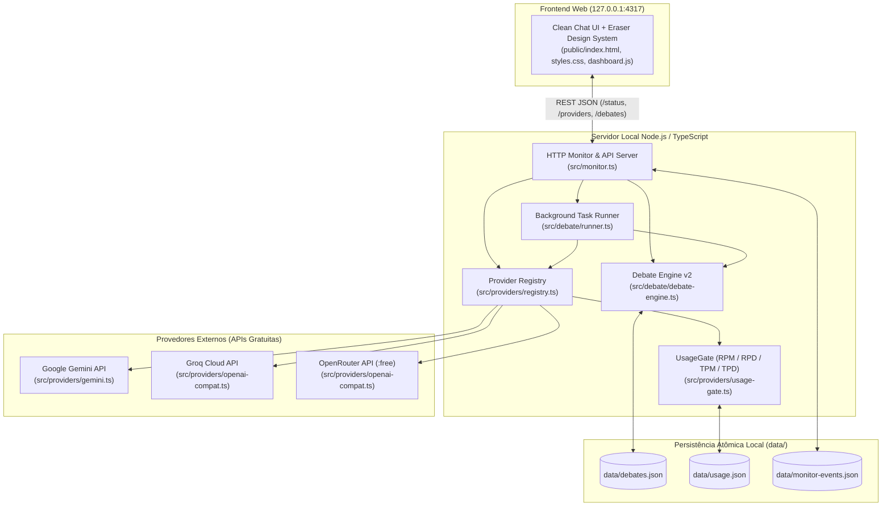

# AI Council — Intelligence Hub

> **Plataforma local de orquestração de debates técnicos multi-IA em rodadas estruturadas, com execução automática via APIs gratuitas, proteção rigorosa de limites (`UsageGate`) e interface conversacional inspirada no Eraser Design System.**

---

## Sumário

1. [Visão Geral](#1-visão-geral)
2. [Arquitetura do Sistema](#2-arquitetura-do-sistema)
3. [Dinâmica dos Debates e Papéis das IAs](#3-dinâmica-dos-debates-e-papéis-das-ias)
4. [Proteção de Cota e Custo Zero (`UsageGate`)](#4-proteção-de-cota-e-custo-zero-usagegate)
5. [Arquitetura Frontend e Design System](#5-arquitetura-frontend-e-design-system)
6. [Estrutura do Projeto](#6-estrutura-do-projeto)
7. [Requisitos, Instalação e Configuração](#7-requisitos-instalação-e-configuração)
8. [Scripts Disponíveis](#8-scripts-disponíveis)
9. [Referência da API HTTP Local](#9-referência-da-api-http-local)
10. [Persistência e Segurança](#10-persistência-e-segurança)
11. [Solução de Problemas (Troubleshooting)](#11-solução-de-problemas-troubleshooting)

---

## 1. Visão Geral

O **AI Council** é um hub de inteligência coletiva que coordena múltiplas inteligências artificiais para analisar problemas complexos, realizar críticas técnicas cruzadas entre pares e consolidar uma **Síntese e Conclusão Conjunta em Markdown** pronta para uso.

### Principais Capacidades
- **Orquestração Multi-IA Híbrida:**
  - **Assentos Automáticos (API):** `Gemini` (Google), `Groq` e `OpenRouter (:free)` respondem automaticamente em paralelo através do runner interno do servidor.
  - **Assentos Manuais Opcionais:** `ChatGPT` (OpenAI) e `Claude` (Anthropic) podem ser incluídos no debate gerando prompts contextuais prontos para cópia e colagem manual, sem automação intrusiva no navegador.
- **Debates em Múltiplas Rodadas com Economia de Tokens:**
  - Suporta de **1 a 3 rodadas de debate** seguidas por uma etapa final de **Síntese**, com compactação inteligente de contexto (`compactForPrompt`) entre rodadas.
- **Garantia de Custo Zero e Resiliência:**
  - Bloqueio em nível de código contra modelos pagos no OpenRouter (exige sufixo `:free`), controle preventivo de RPM/RPD/TPM/TPD e pausa automática em caso de limite atingido, permitindo retomar do ponto exato sem perda de respostas.

---

## 2. Arquitetura do Sistema



---

## 3. Dinâmica dos Debates e Papéis das IAs

### 3.1. Ciclo de Vida das Etapas (`DebateStage`)
1. **`initial_response` (Rodada 1 — Análise Inicial):**
   Cada IA participante analisa o problema original sob a ótica do seu papel técnico específico e propõe uma solução prática e enxuta (teto de `1.100 tokens`).
2. **`critique` (Rodadas 2 a N — Crítica Cruzada e Refinamento):**
   Cada IA recebe um resumo compactado (`até 3.000 caracteres` por resposta, preservando início e fim) das propostas da rodada anterior, aponta até 3 falhas objetivas e entrega uma versão corrigida e consolidada (teto de `1.100 tokens`).
3. **`synthesis` (Etapa Final — Síntese e Conclusão Conjunta):**
   O relator do conselho (prioritariamente o `Gemini`, ou o primeiro provedor automático participante) recebe as posições finais (`até 4.500 caracteres` por resposta) e redige o documento final com a **Solução Final** e a **Conclusão do Conselho** (teto de `1.600 tokens`).
4. **`completed` (Finalizado):**
   A síntese é gravada em `debate.conclusion` e exibida em destaque no final do chat.

### 3.2. Matriz de Papéis por Foco de Trabalho (`DebateFocus`)

| Plataforma | Foco: `geral` | Foco: `backend` | Foco: `frontend` |
| :--- | :--- | :--- | :--- |
| **Gemini** *(auto)* | **Arquiteto e relator:** propõe a arquitetura principal, código essencial e redige a síntese final. | **Arquiteto e relator:** propõe estrutura, contratos e consolida a solução. | **Arquiteto e relator:** estrutura componentes, estado e consolida o código. |
| **Groq** *(auto)* | **Revisor técnico:** foca em bugs prováveis, segurança, tratamento de erros e casos de borda. | **Revisor técnico:** audita vulnerabilidades, concorrência, validação e falhas de borda. | **Revisor técnico:** audita XSS, acessibilidade, performance e estados de erro. |
| **OpenRouter** *(auto)* | **Voz alternativa:** propõe uma abordagem diferente da mais óbvia, explicando os trade-offs. | **Revisor de simplicidade:** corta complexidade acidental, acoplamento e dívida técnica. | **Revisor de UX e estética:** aplica regras estritas contra visual genérico de IA. |
| **ChatGPT** *(manual)* | **Autor alternativo:** questiona premissas ignoradas e propõe solução complementar. | **Autor alternativo:** explora arquitetura alternativa e trade-offs práticos. | **Autor alternativo:** propõe padrões de interação e layout alternativos. |
| **Claude** *(manual)* | **Revisor de qualidade:** prioriza clareza, legibilidade, bons nomes e fácil manutenção. | **Revisor de qualidade:** refina código limpo, tipagem e manutenibilidade. | **Revisor de qualidade:** refina semântica HTML, CSS modular e clareza. |

---

## 4. Proteção de Cota e Custo Zero (`UsageGate`)

O módulo `src/providers/usage-gate.ts` atua como um *circuit breaker* e *rate limiter* local antes de qualquer requisição sair para a internet:

- **Margem de Segurança (`USAGE_SAFETY`):** Por padrão opera em `0.9` (90%), interrompendo o uso local **antes** de atingir o teto real do provedor.
- **Controle por Minuto (RPM / TPM):** Mantém uma janela deslizante de 60 segundos em memória. Se o limite por minuto estiver próximo (ex.: `8.000 tokens/min` na Groq), o `UsageGate` aguarda automaticamente a liberação da janela antes de disparar a requisição.
- **Controle Diário Persistente (RPD / TPD):** Gravado atomicamente em `data/usage.json`, respeitando o fuso horário de referência de cada provedor (`America/Los_Angeles` para o Gemini; `UTC` para Groq e OpenRouter).
- **Trava Estrita `:free` no OpenRouter:** Em `src/providers/registry.ts`, qualquer modelo configurado em `OPENROUTER_MODELS` cujo ID não termine em `:free` é recusado imediatamente na inicialização.
- **Fallback Automático de Modelos:** Cada provedor aceita uma lista ordenada de modelos (principal + reservas). Em caso de indisponibilidade ou erro de modelo/rate-limit temporário, o cliente tenta o próximo modelo da fila respeitando o limite máximo de tentativas (`maxHttpAttempts`).

---

## 5. Arquitetura Frontend e Design System

A interface web (`public/index.html`, `public/styles.css`, `public/dashboard.js`) adota uma arquitetura **Clean Chat-First** combinada ao **Eraser Design System (Neon Blueprint on Black Velvet)**:

- **Layout em 3 Regiões Retráteis (`100vw × 100vh`):**
  1. **Sidebar Esquerda Retrátil (`#left-sidebar`):** Botão `+ Novo Debate →`, seções colapsáveis para **Navegação do Sistema** (*Chat Central*, *Resumo & Monitoramento*, *Atividade & Histórico*) e **Conversas / Debates**, além do rodapé compacto com status do servidor e relógio.
  2. **Palco Central (`#main-stage`):** Conversa centralizada (`860px`), blocos retráteis de raciocínio por rodada (`Pensando... 00:00.0s` → `Pensou por X.Xs — Rodada N`), cards de respostas individuais colapsáveis com renderização segura de Markdown/código e **AI Prompt Panel** fixo na base.
  3. **Dock Direito Compacto (`#right-ai-panel`):** Exibe exclusivamente as **3 IAs automáticas** (`Gemini`, `Groq`, `OpenRouter`) com seus ícones vetoriais SVG reais, cronômetro ao vivo (`100ms`), aviso de conclusão (`✔ Concluído • Xs`) e micro-barra de limite diário (`reqHoje/reqMax req`).
- **Tokens Visuais Principais:**
  - Superfície principal: `--color-obsidian` (`#181818`) e blocos de código em `--color-ink-black` (`#080808`).
  - Acentos técnicos: `--color-iris-glow` (`#9985ff`), `--color-sky-pulse` (`#94dbff`), `--color-saffron-whisper` (`#d6ca6f`) e `--color-rose-quartz` (`#ffa3c2`).
  - Sombras sólidas sem blur: `--shadow-subtle` (`6px 6px 0px 0px #080808`) e `--shadow-subtle-2` (`6px 6px 0px 0px #363054`).

---

## 6. Estrutura do Projeto

```text
AI-Council/
├── data/                        # Persistência local JSON (criada automaticamente)
│   ├── debates.json             # Histórico e estado completo das sessões de debate
│   ├── usage.json               # Contadores diários de requisições e tokens por IA
│   └── monitor-events.json      # Eventos de alerta/limite registrados pelo monitor
├── public/                      # Frontend Web (Clean Chat + Eraser Design System)
│   ├── index.html               # App Shell em 3 colunas retráteis
│   ├── styles.css               # Tokens e estilos do Eraser Design System
│   └── dashboard.js             # Estado reativo, timers de 100ms, Markdown e chamadas HTTP
├── scripts/                     # Utilitários de linha de comando (CLI)
│   ├── list-free-models.ts      # Lista modelos gratuitos disponíveis nos provedores
│   ├── list-models.ts           # Inspeção geral de modelos
│   └── test-providers.ts        # Diagnóstico e teste real/dry-run das chaves de API
├── src/                         # Backend TypeScript
│   ├── debate/
│   │   ├── debate-engine.ts     # Máquina de estados do debate, prompts e síntese
│   │   └── runner.ts            # Loop assíncrono que executa tarefas automáticas em paralelo
│   ├── persistence/
│   │   └── debate-store.ts      # Leitura/escrita atômica com fila de lock em data/debates.json
│   ├── providers/
│   │   ├── gemini.ts            # Adaptador Google GenAI SDK com fallback de modelos
│   │   ├── openai-compat.ts     # Adaptador OpenAI-compatible para Groq e OpenRouter
│   │   ├── policy.ts            # Políticas e estimativas de tokens
│   │   ├── registry.ts          # Inicialização de provedores, limites e snapshots
│   │   ├── types.ts             # Contratos de provedores e classificação de erros
│   │   └── usage-gate.ts        # Controle de cota por minuto e por dia (UsageGate)
│   ├── shared/
│   │   └── debate-types.ts      # Tipagens compartilhadas de sessões, tarefas e respostas
│   └── monitor.ts               # Servidor HTTP nativo (127.0.0.1:4317), rotas e segurança
├── .env.example                 # Template de variáveis de ambiente
├── package.json                 # Dependências e scripts NPM
└── tsconfig.json                # Configuração do compilador TypeScript
```

---

## 7. Requisitos, Instalação e Configuração

### 7.1. Pré-requisitos
- **Node.js** `v20+` (recomendado `v22+`)
- Chaves de API gratuitas para:
  - **Google AI Studio (Gemini):** `GEMINI_API_KEY`
  - **Groq Cloud:** `GROQ_API_KEY`
  - **OpenRouter:** `OPENROUTER_API_KEY`

### 7.2. Instalação
```powershell
npm.cmd install
```
*(No Windows PowerShell, utilize `npm.cmd` caso a política de execução bloqueie scripts `.ps1`).*

### 7.3. Configuração do `.env`
Copie o arquivo `.env.example` para `.env` na raiz do projeto e preencha suas chaves:

| Variável | Obrigatória | Padrão | Descrição |
| :--- | :---: | :--- | :--- |
| `MONITOR_TOKEN` | **Sim** | — | Token de segurança local (mínimo de 32 caracteres). |
| `GEMINI_API_KEY` | **Sim** | — | Chave de API do Google AI Studio. |
| `GROQ_API_KEY` | **Sim** | — | Chave de API da Groq Cloud. |
| `OPENROUTER_API_KEY` | **Sim** | — | Chave de API do OpenRouter. |
| `GEMINI_MODELS` | Não | `gemini-3.5-flash-lite,gemini-3.5-flash` | Lista de modelos Gemini (principal + reservas). |
| `GROQ_MODELS` | Não | `openai/gpt-oss-120b,openai/gpt-oss-20b` | Lista de modelos Groq (principal + reservas). |
| `OPENROUTER_MODELS` | Não | `nvidia/nemotron-3-ultra-550b-a55b:free,...` | Lista de modelos OpenRouter (**todos devem terminar em `:free`**). |
| `GEMINI_RPM` / `GEMINI_RPD` | Não | `5` / `100` | Limites por minuto e por dia do Gemini. |
| `GROQ_RPM` / `GROQ_RPD` | Não | `30` / `1000` | Limites de requisições da Groq. |
| `GROQ_TPM` / `GROQ_TPD` | Não | `8000` / `200000` | Limites de tokens por minuto e por dia da Groq. |
| `OPENROUTER_RPM` / `OPENROUTER_RPD` | Não | `20` / `50` | Limites de requisições do OpenRouter gratuito. |
| `USAGE_SAFETY` | Não | `0.9` | Fator de segurança local (`0.9` = trava em 90% da cota). |

---

## 8. Scripts Disponíveis

| Comando | Descrição |
| :--- | :--- |
| `npm.cmd run test:providers:dry` | Valida as chaves e configurações do `.env` sem realizar chamadas externas. |
| `npm.cmd run test:providers` | Executa 1 chamada mínima por provedor para testar conectividade e modelos. |
| `npm.cmd run list-models` | Lista modelos gratuitos disponíveis nas APIs configuradas. |
| `npm.cmd run monitor` | Inicia o servidor local e o runner automático em `http://127.0.0.1:4317`. |
| `npm.cmd run dev` | Inicia o servidor em modo *watch* (recarrega ao editar arquivos em `src/`). |
| `npm.cmd run build` | Compila o projeto TypeScript para JavaScript na pasta `dist/`. |
| `npm.cmd run start` | Executa a versão compilada (`node dist/monitor.js`). |

---

## 9. Referência da API HTTP Local

O servidor escuta exclusivamente em `http://127.0.0.1:4317` e valida origem (`same-origin`) ou o cabeçalho `X-AI-Council-Token`.

### `GET /health`
Verifica a saúde do servidor.
- **Resposta `200 OK`:**
  ```json
  {
    "status": "online",
    "service": "ai-council-usage-monitor",
    "timestamp": "2026-11-17T16:00:00.000Z"
  }
  ```

### `GET /status`
Retorna o resumo de eventos do monitor e todas as sessões de debate armazenadas.
- **Resposta `200 OK`:**
  ```json
  {
    "status": "online",
    "totalEvents": 0,
    "latestEvents": [],
    "activeDebatesCount": 1,
    "debates": [ /* Array de DebateSession */ ]
  }
  ```

### `GET /providers`
Retorna o estado de prontidão, modelos configurados e consumo diário (`UsageGate`) dos 3 provedores automáticos (`gemini`, `groq`, `openrouter`).
- **Resposta `200 OK`:**
  ```json
  {
    "providers": [
      {
        "id": "gemini",
        "name": "Gemini",
        "ready": true,
        "reason": null,
        "models": ["gemini-3.5-flash-lite", "gemini-3.5-flash"],
        "usage": {
          "day": "2026-11-17",
          "requestsToday": 7,
          "tokensToday": 10823,
          "requestsDailyCap": 90,
          "tokensDailyCap": null,
          "requestsPerMinuteCap": 4,
          "tokensPerMinuteCap": 180000
        }
      }
    ]
  }
  ```

### `POST /debates`
Cria e inicia imediatamente uma nova sessão de debate (pausando sessões anteriores que estivessem em execução).
- **Corpo da Requisição:**
  ```json
  {
    "title": "Arquitetura de microsserviços vs. monolito modular",
    "topic": "Compare as abordagens para uma equipe de 8 desenvolvedores...",
    "rules": "Seja direto e concreto.",
    "participants": ["gemini", "groq", "openrouter"],
    "totalRounds": 2,
    "focus": "backend"
  }
  ```
- **Resposta `201 Created`:** `{ "created": true, "debate": { ... } }`

### `POST /debates/:id/respond`
Registra manualmente a resposta de uma tarefa pendente (utilizado para assentos manuais como `ChatGPT` e `Claude`).
- **Corpo da Requisição:** `{ "taskId": "uuid-da-tarefa", "content": "Texto em Markdown..." }`

### `POST /debates/:id/pause` e `POST /debates/:id/resume`
Pausa manualmente um debate em andamento preservando seu estado ou retoma a execução exatamente da tarefa pendente onde parou.

---

## 10. Persistência e Segurança

- **Gravação Atômica com Lock:** Tanto `data/debates.json`, `data/usage.json` quanto `data/monitor-events.json` utilizam filas de execução em memória (`withDebateLock` / `persistQueue`) e escrita em arquivo temporário (`.tmp`) seguida de `rename` atômico, impedindo corrupção de dados mesmo em execuções paralelas das IAs.
- **Isolamento de Rede Local:** O servidor faz *bind* estrito em `127.0.0.1` (loopback local) e bloqueia requisições de origens externas via verificação de `Host`, `Origin` e `Sec-Fetch-Site`.
- **Proteção contra Echo de Prompt:** Ao colar respostas manuais, a engine valida se o usuário não colou acidentalmente o próprio enunciado do prompt antes de avançar a etapa.

---

## 11. Solução de Problemas (Troubleshooting)

| Sintoma | Causa Provável | Solução |
| :--- | :--- | :--- |
| **Erro de execução de script no PowerShell (`npm.ps1`)** | Política `ExecutionPolicy` restrita do Windows. | Utilize `npm.cmd` em vez de `npm` (ex.: `npm.cmd run monitor`). |
| **Card da IA exibe `Sem chave`** | Chave ausente no `.env` ou modelo sem sufixo `:free` no OpenRouter. | Verifique o arquivo `.env` e rode `npm.cmd run test:providers:dry`. |
| **Debate entra em `Pausado (Erro no Provedor)`** | Nome de modelo descontinuado ou falha de autenticação na API. | Execute `npm.cmd run list-models`, atualize o `.env` e clique em **`Retomar →`** no topo do chat. |
| **Debate entra em `Pausado (Limite Gratuito Atingido)`** | Cota diária (`UsageGate`) ou rate-limit (`429`) atingido em um dos provedores. | Aguarde a renovação da janela de tempo (ou ajuste os limites no `.env`) e clique em **`Retomar →`**. |
