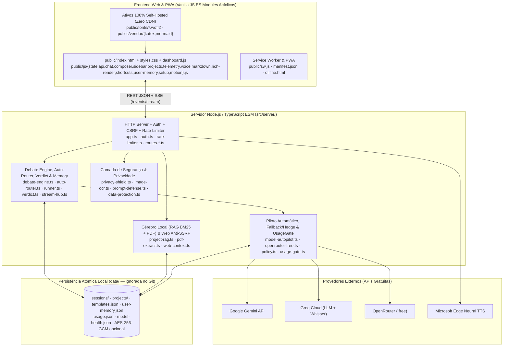

# AI Council — Intelligence Hub

**Orquestrador local-first multi-IA (Gemini, Groq e OpenRouter) com custo zero, streaming paralelo via SSE, Piloto Automático de Modelos (*Hedged Requests* + backoff exponencial), Cérebro Local por Projeto (RAG BM25), voz neural individual e arquitetura *Security & Privacy by Design*.**

`Node.js 20+` · `TypeScript (ESM)` · `Vanilla JS ES Modules (zero framework)` · `SSE Streaming` · `AES-256-GCM / scrypt` · `Zero CDN` · `97 testes automatizados`

---

## Sumário

- [Visão Geral](#visão-geral)
- [Destaques de Engenharia](#destaques-de-engenharia)
- [Arquitetura do Sistema](#arquitetura-do-sistema)
- [Decisões Técnicas & Trade-offs](#decisões-técnicas--trade-offs)
- [Início Rápido (Quick Start)](#início-rápido-quick-start)
- [Modos de Uso & Orçamento Dinâmico](#modos-de-uso--orçamento-dinâmico)
- [Estrutura do Projeto](#estrutura-do-projeto)
- [Variáveis de Ambiente & Scripts](#variáveis-de-ambiente--scripts)
- [Testes Automatizados & Auditoria Contínua](#testes-automatizados--auditoria-contínua)
- [Segurança & Privacidade](#segurança--privacidade)

---

## Visão Geral

O **AI Council** transforma APIs gratuitas de diferentes provedores de IA em um único ambiente de trabalho privado, resiliente e rápido — executando localmente no computador e acessível no celular como **PWA** (via rede local ou túnel HTTPS privado).

Em vez de depender de uma única IA ou de assinaturas pagas, o sistema permite:
- Consultar **1 IA**, o **Roteador Inteligente (`Auto` 0ms)** ou o **Trio em paralelo** (`Gemini` + `Groq` + `OpenRouter :free`) com streaming token a token.
- Conduzir **Debates estruturados** (análise inicial → crítica cruzada → síntese final) ou gerar um **Veredito do Conselho** apontando consensos, divergências e a resposta mais forte.
- Trabalhar com **Projetos (Cérebro Local)** alimentados por instruções fixas, PDFs, uploads e pastas locais somente leitura indexadas por **BM25**.
- Proteger dados sensíveis com **Escudo DLP Híbrido + OCR local offline** e **Cofre criptografado (`AES-256-GCM`)**.

---

## Destaques de Engenharia

### 1. Orquestração, Roteamento e Resiliência de LLMs
- **Roteador Inteligente (`Auto` em 0ms):** seleciona automaticamente `Groq`, `Gemini`, multimodal ou `Trio` conforme complexidade da pergunta, anexos (imagem/PDF), tamanho do contexto e cota livre em tempo real — sem gastar chamadas extras de classificação.
- **Piloto Automático de Modelos (Gemini, Groq e OpenRouter):**
  - Auto-descoberta de catálogos (`/models`, cache de 6h, **0 tokens / 0 requisições de geração**) com **allowlists estritas de custo zero** (`:free` + preço `0` no OpenRouter; apenas famílias `Flash`/`Gemma` no Gemini; apenas modelos de chat ativos na Groq).
  - **Corrida cirúrgica (*Hedged Request* de 5s) no Gemini:** se o modelo mais novo (`ex.: gemini-3.8-flash`) ficar mudo por mais de 5s ou devolver `503`, o reserva rápido (`gemini-3.5-flash-lite`) dispara em paralelo, vence sem misturar tokens no streaming e coloca o modelo congestionado em **cooldown exponencial (`1h → 3h → 8h`)** persistido em disco — com guarda de folga de RPM (`5 RPM`) e cota diária (>25%).
  - **Quarentena automática de 24h** para modelos que retornam `429` com `limit: 0` no plano gratuito.
- **Trava Preventiva de Custo Zero (`UsageGate`):** janela deslizante de 60s (`RPM`/`TPM`) + contador diário persistido (`RPD`/`TPD`) com margem de segurança de **90%** (`USAGE_SAFETY=0.9`) e cancelamento real via `AbortController`.

### 2. Segurança & Privacidade por Design
- **Escudo de Privacidade (DLP Híbrido + OCR Local):** detecta chaves de API, chaves PEM, JWT, credenciais, CPF/CNPJ (Mod-11), cartões (Luhn), e-mails e telefones antes do envio; inspeciona imagens anexadas offline no Windows (`Windows.Media.Ocr`) e aplica tarjas automáticas ou manuais via `<canvas>`.
- **Cofre Local em Repouso (`AES-256-GCM`):** criptografia opcional de todo o armazenamento local em dois modos — **Automático (Windows DPAPI)** ou **Senha Mestra** (*Envelope Encryption* com `scrypt` + Chave de Recuperação + chave mantida apenas em RAM + auto-bloqueio por inatividade + selagem opcional de chaves de API).
- **Defesa Web & Prompt Defense:** CSP 100% local (**zero CDNs externas**), fontes e bibliotecas (`KaTeX`/`Mermaid`) auto-hospedadas, proteção anti-SSRF com validação DNS + redirecionamentos manuais, rate-limiting por categoria de rota (`429` + `Retry-After`), sessões opacas revogáveis (`HttpOnly` + hash SHA-256), defesa CSRF e isolamento `<untrusted_data>` contra Prompt Injection indireto.
- **Auditoria Contínua (`npm run security:check`):** verifica em um comando segredos/dados pessoais no Git, integridade da CSP, `npm audit`, permissões NTFS e suítes críticas de segurança e integridade ESM.

### 3. Cérebro Local (RAG), Multimodalidade e Voz
- **Projetos com RAG BM25 (0 custo de API):** extração local de PDFs (`unpdf`), chunking com sobreposição, ranking BM25 sem acentos, cache com invalidação por `mtime` e scanner de pastas locais em modo **somente leitura** com bloqueio rígido de segredos (`.env`, `.git`, `*.key`, `*.pem`, binários).
- **Anexos Multimodais Universais:** arrastar/soltar ou colar (`Ctrl+V`) prints, imagens (compressão automática + lightbox) e PDFs acessíveis tanto por modelos multimodais quanto por modelos somente texto (via extração local).
- **Voz Ponta a Ponta:** entrada por voz via **Groq Whisper** (*segurar para gravar*) e leitura individual por IA + modo **"Ouvir Conselho"** via **Microsoft Edge Neural TTS** com cache LRU e mini-player flutuante.

### 4. Experiência de Chat & Produtividade
- **Renderização Rica 100% Local:** `KaTeX` (com proteção contra valores monetários como `R$ 50`) e `Mermaid` (tema escuro integrado, alternância *Diagrama / Código*, tela cheia, download SVG e sanitização XSS), carregados sob demanda (**0 KB** extras em conversas comuns) e com streaming sem piscar.
- **Navegação por Teclado:** Paleta de Comandos (**`Ctrl+K`**) para buscar conversas, projetos, templates e executar ações; menu **`/`** no campo de mensagem para inserir templates rapidamente; **`Alt+N`** para nova conversa.
- **Memória Pessoal Automática & Rewind:** extrai preferências úteis automaticamente em segundo plano (com filtro anti-segredos e controle total de pausa/exclusão), além de permitir **editar e reenviar qualquer turno** preservando anexos e recalculando o contexto.
- **Desktop & Mobile:** bandeja do sistema no Windows (`scripts/win/`), PWA instalável (`manifest.json`, `sw.js`, `offline.html`) e **Setup Guiado em 1 passo** no primeiro acesso local.

---

## Arquitetura do Sistema



---

## Decisões Técnicas & Trade-offs

| Decisão | Motivação | Trade-off assumido |
| :--- | :--- | :--- |
| **Arquitetura Local-First (sem backend SaaS)** | Privacidade máxima, latência zero de banco local e custo zero de infraestrutura. | Depende do PC ligado para acesso remoto via PWA/Tailscale. |
| **Frontend em Vanilla JS ES Modules (zero framework/bundler)** | Zero build de frontend, boot instantâneo, CSP rígida sem `unsafe-eval` e 0 dependências JS de UI; integridade garantida por teste automatizado de grafo acíclico (`frontend-integrity.test.ts`). | Exige disciplina manual de DOM e estado modularizado (`state.js` + `uiHooks`). |
| **Hedged Request (5s) + Saúde Persistida em vez de Sonda no Boot** | Evita gastar cota gratuita em reinícios do servidor e protege contra congestionamento que começa no meio do dia, preservando o limite de `5 RPM` do Gemini via `canHedgeSafely()`. | Na 1ª detecção de lentidão após um cooldown expirar, o hedge consome 2 requisições antes de pausar o modelo por `1h → 3h → 8h`. |
| **Ativos 100% Self-Hosted (fontes, KaTeX, Mermaid)** | Elimina dependências de CDNs externas, previne rastreamento e permite CSP `default-src 'self'` estrita com suporte offline. | Pequeno aumento no repositório local (~2,9 MB de assets estáticos), carregados sob demanda (`lazy-loading`). |
| **Persistência em JSON atômico (`tmp` + `rename`) + `AES-256-GCM`** | Portabilidade trivial, backup em 1 clique, zero dependência nativa de compilação (C++/SQLite) no Windows e criptografia transparente em repouso. | Indicado para uso individual/local; cenários multi-usuário corporativos exigiriam banco relacional dedicado. |

---

## Início Rápido (Quick Start)

### Pré-requisitos
- **Node.js `v20+`** (recomendado `v22+`)
- Chaves gratuitas de API em:
  - [Google AI Studio (Gemini)](https://aistudio.google.com/apikey)
  - [Groq Console](https://console.groq.com/keys)
  - [OpenRouter](https://openrouter.ai/keys)

### 1. Instalar e compilar
```bash
git clone <url-do-repositorio>
cd AI-Council
npm install
npm run build
```

### 2. Iniciar o servidor
```bash
npm start
```
*(No Windows PowerShell, caso `ExecutionPolicy` bloqueie `npm.ps1`, use `npm.cmd`.)*

### 3. Configurar em 1 passo no navegador
1. Abra **`http://127.0.0.1:4317`** no PC local.
2. O **Setup Guiado** (disponível exclusivamente em `localhost`) cria o `.env` automaticamente, gera um `MONITOR_TOKEN` criptográfico de 64 caracteres, valida suas 3 chaves online (gastando 0 tokens) e ativa as IAs em memória sem reiniciar o servidor.
3. Para uso no dia a dia no Windows, você pode instalar os atalhos e o ícone de bandeja com:
   ```powershell
   npm.cmd run install:shortcuts
   ```

---

## Modos de Uso & Orçamento Dinâmico

### Modos no Composer
- **Seleção de IA:** `Auto` (roteador inteligente 0ms), `1 IA` (direto) ou `Trio` (execução paralela).
- **Formato:** `Normal` (conversa direta) ou `Prompt MD` (entrega técnica estruturada com foco `Geral`, `Backend` ou `Frontend`).
- **Dinâmica:** `Direto` (1 rodada) ou `Debate` (1 a 3 rodadas de crítica cruzada + síntese final).

### Orçamento Adaptativo por Provedor (`src/shared/context-budget.ts`)
Cada IA recebe contexto proporcional à sua janela gratuita para evitar estouros de `TPM`:

| Orçamento (caracteres) | Gemini | OpenRouter (`:free`) | Groq Gratuito (8k TPM) |
| :--- | :---: | :---: | :---: |
| Histórico unificado | `24.000` | `20.000` | `7.500` |
| Anexos de texto | `22.000` | `18.000` | `4.500` |
| Contexto de Projeto (RAG) | `16.000` | `12.000` | `3.000` |
| Contexto Web (links/busca) | `6.500` | `6.000` | `2.200` |
| Memória Compartilhada | `2.800` | `2.400` | `2.000` |

---

## Estrutura do Projeto

```text
AI-Council/
├── public/                             # Frontend Web & PWA (zero CDN)
│   ├── index.html / styles.css / dashboard.js
│   ├── manifest.json / sw.js / offline.html
│   ├── fonts/                          # Inter, JetBrains Mono e Oswald (.woff2)
│   ├── vendor/                         # KaTeX e Mermaid self-hosted (lazy-loaded)
│   └── js/                             # 14 módulos ESM acíclicos
├── src/
│   ├── debate/                         # debate-engine, auto-router, runner, verdict, stream-hub, user-memory-extractor
│   ├── persistence/                    # debate-store, project-store, template-store, user-memory-store
│   ├── projects/                       # project-rag (BM25 + FS seguro), pdf-extract (unpdf)
│   ├── providers/                      # model-autopilot, openrouter-free, policy (fallback/hedge), usage-gate, gemini, openai-compat, whisper, tts, registry
│   ├── security/                       # data-protection (AES-256-GCM/scrypt/DPAPI/NTFS), privacy-shield, image-ocr, prompt-defense, rate-limiter
│   ├── server/                         # app, auth, http-utils, static-files, env-config, events-store, routes-{audio,debates,memory,privacy,projects,setup,templates}
│   ├── shared/                         # debate-types, context-budget
│   ├── web/                            # web-context (busca gratuita, leitor de URLs e anti-SSRF)
│   └── monitor.ts                      # Entrypoint HTTP + inicialização do ambiente
├── scripts/
│   ├── security-check.ts               # Auditoria automatizada de segurança (5 controles)
│   ├── win/                            # Bandeja do Windows e instalador de atalhos
│   └── test-providers.ts / list-free-models.ts / tunnel.ts
├── tests/                              # 21 suítes · 97 testes automatizados (node:test via tsx)
├── SECURITY.md                         # Política e arquitetura de segurança
├── PRIVACY.md                          # Fluxo de dados e controles de privacidade (LGPD)
└── .env.example                        # Modelo limpo de configuração
```

---

## Variáveis de Ambiente & Scripts

### Principais Variáveis (`.env` — nunca versionado)

| Variável | Obrigatória | Padrão | Descrição |
| :--- | :---: | :--- | :--- |
| `GEMINI_API_KEY` | **Sim** | — | Chave da API do Google AI Studio. |
| `GROQ_API_KEY` | **Sim** | — | Chave da API da Groq Cloud (LLM + Whisper). |
| `OPENROUTER_API_KEY` | **Sim** | — | Chave da API do OpenRouter. |
| `MONITOR_TOKEN` | Auto | Gerado (64 chars) | Token local de segurança criado no primeiro boot. |
| `ACCESS_PASSWORD` | Rec. | — | Senha forte (mín. 8–12+ chars) para acesso remoto (Wi-Fi / HTTPS). |
| `REQUIRE_PASSWORD_LOCAL` | Não | `false` | Se `true`, exige senha também em `127.0.0.1`. |
| `GEMINI_MODELS` / `GROQ_MODELS` | Não | Automático | Modelos preferidos (combinados ao Piloto Automático). |
| `OPENROUTER_MODELS` | Não | `...:free` | Lista preferida no OpenRouter (**somente `:free`**). |
| `USAGE_SAFETY` | Não | `0.9` | Margem preventiva de cota (`0.9` = trava em 90%). |
| `HOST` / `PORT` | Não | `0.0.0.0` / `4317` | Interface e porta do servidor HTTP. |
| `AI_COUNCIL_DATA_DIR` | Não | `./data` | Diretório alternativo de armazenamento local. |

### Scripts (`package.json`)

| Comando | Descrição |
| :--- | :--- |
| `npm run build` | Compila TypeScript (`src/` → `dist/`). |
| `npm start` | Inicia o servidor compilado (`node dist/monitor.js`). |
| `npm run dev` | Executa em modo *watch* recarregando alterações em `src/`. |
| `npm test` | Executa toda a suíte automatizada (**97 testes em 21 suítes**). |
| `npm run security:check` | Executa os **5 controles automatizados de segurança** (Git, CSP/Zero-CDN, `npm audit`, NTFS e testes de segurança/ESM). |
| `npm run test:providers:dry` | Valida `.env` e política de modelos sem chamadas externas. |
| `npm run tray` / `install:shortcuts` | Bandeja do Windows e criação de atalhos no sistema. |

---

## Testes Automatizados & Auditoria Contínua

A suíte utiliza `node:test` nativo via `tsx` sem dependências pesadas de teste (**97 testes passando em ~2,5s**):

- **Segurança & Privacidade:** `security-server.test.ts`, `privacy-shield-and-storage.test.ts`, `prompt-defense-and-markdown.test.ts`, `web-context.test.ts` (autenticação, sessões revogáveis, CSRF, rate-limit, anti-SSRF + DNS rebinding, DLP, criptografia `AES-256-GCM`/DPAPI/Senha Mestra, Prompt Injection e sanitização XSS).
- **Orquestração & Resiliência:** `model-autopilot.test.ts`, `openrouter-free-and-shortcuts.test.ts`, `auto-router.test.ts`, `usage-gate.test.ts`, `debate-engine.test.ts`, `verdict.test.ts`, `auto-verdict-and-web-cache.test.ts`, `context-budget.test.ts`.
- **RAG, Multimodalidade, Voz & Setup:** `projects.test.ts`, `pdf-and-cache.test.ts`, `voice.test.ts`, `user-memory-and-edit.test.ts`, `setup-wizard.test.ts`.
- **Integridade do Frontend ESM:** `frontend-integrity.test.ts` (`node --check` em todos os módulos, validação de grafo de imports **100% acíclico**, checagem de símbolos exportados/importados e boot simulado).

---

## Segurança & Privacidade

- Arquitetura de defesa, modelo de ameaças, limitações conhecidas e canal de reporte: **[SECURITY.md](SECURITY.md)**
- Inventário de armazenamento local, operadores externos e controles de privacidade (LGPD): **[PRIVACY.md](PRIVACY.md)**
