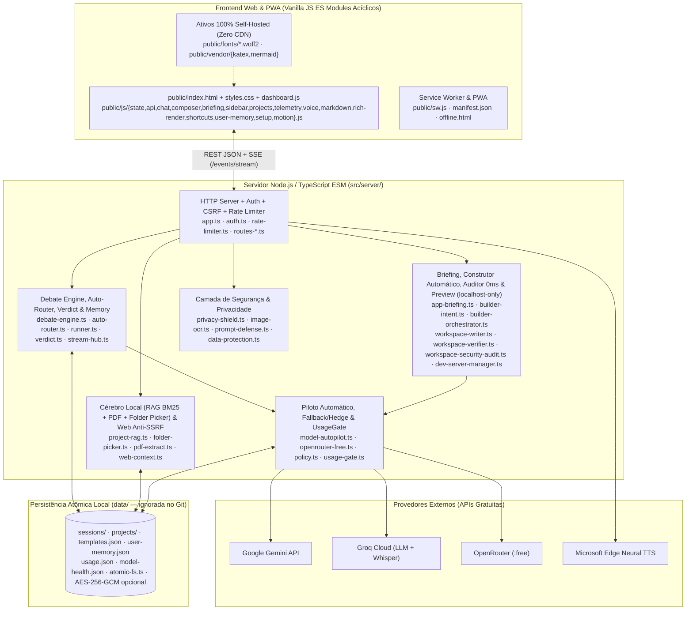

# AI Council — Intelligence Hub

**Orquestrador local-first multi-IA (Gemini, Groq e OpenRouter) com custo zero, Briefing 1-Frase com Expansor OWASP/LGPD, Modo Construtor 100% Automático na pasta com Auto-Fix + Mini-Auditor 0 ms, Preview App ao vivo (`▶ Rodar & Abrir App`), streaming paralelo via SSE, RAG BM25, voz neural individual e arquitetura *Security & Privacy by Design*.**

`Node.js 20+` · `TypeScript (ESM)` · `Vanilla JS ES Modules (zero framework)` · `SSE Streaming` · `Auto-Builder + Preview App` · `AES-256-GCM / scrypt` · `Zero CDN` · `126 testes automatizados`

---

## Sumário

- [Visão Geral](#visão-geral)
- [Destaques de Engenharia](#destaques-de-engenharia)
- [Arquitetura do Sistema](#arquitetura-do-sistema)
- [Decisões Técnicas & Trade-offs](#decisões-técnicas--trade-offs)
- [Início Rápido (Quick Start)](#início-rápido-quick-start)
- [Modos de Uso & Orçamento Dinâmico](#modos-de-uso--orçamento-dinâmico)
- [Estrutura do Projeto](#estrutura-do-projeto)
- [Variáveis de Ambiente & Scripts](#variáveis-de-ambiente--scripts)
- [Testes Automatizados & Auditoria Contínua](#testes-automatizados--auditoria-contínua)
- [Portfólio & Apresentação](#portfólio--apresentação)
- [Segurança & Privacidade](#segurança--privacidade)

---

## Visão Geral

O **AI Council** transforma APIs gratuitas de diferentes provedores de IA em um ambiente completo de conversa, análise multi-IA e **construção real de aplicações na pasta do PC** — executando localmente com custo zero e acessível no celular como **PWA** (via rede local ou túnel HTTPS privado).

Em vez de depender de uma única IA, configurar projetos manualmente ou copiar/colar blocos de código, o sistema permite:
- **Criar apps funcionais a partir de 1 frase simples** (sem precisar criar pasta ou escrever instruções técnicas antes): o **Briefing Rápido** cria a subpasta, aplica boas práticas **OWASP / Financeiro / LGPD** automaticamente, gera os arquivos, instala dependências, valida build + testes + auditoria de segurança e oferece **`▶ Rodar & Abrir App`** direto no navegador.
- Usar o **Modo `Auto` padrão (0 ms)** ou escolher livremente entre **Chat Rápido (1 IA)**, **Conselho (Trio em paralelo + Veredito)** e **Debate (crítica cruzada + síntese final)** com streaming token a token.
- Trabalhar com **Projetos (Cérebro Local)** alimentados por instruções fixas, PDFs, uploads e pastas locais (com seletor nativo do Windows + criação de subpastas) indexadas por **BM25**.
- Proteger dados sensíveis com **Escudo DLP Híbrido + OCR local offline**, **Cofre criptografado (`AES-256-GCM`)** e **Mini-Auditor estático de segurança 0 ms**.

---

## Destaques de Engenharia

### 1. Briefing 1-Frase, Expansor OWASP/LGPD & Tela Inicial Guiada
- **Tela Inicial por Objetivo:** ao abrir uma nova conversa, 3 cartões diretos guiam o fluxo sem tutoriais invasivos — **Criar App ou Site na Pasta**, **Consultar o Conselho** e **Continuar um Projeto** (com atalhos clicáveis para os projetos recentes), mantendo os templates rápidos em 1 linha discreta logo abaixo.
- **Briefing Rápido inline (`app-briefing.ts`, `briefing.js`):** em uma conversa nova sem projeto vinculado no PC local, digitar uma frase simples (ex.: *"Cria um app de controle de gastos pessoais"*) muda o botão para **`Preparar Novo App →`** e abre um mini-card inline sugerindo nome/subpasta (`Desktop\<NomeDoApp>` com botão `Trocar pasta...`), tipo (*App Web*, *API Backend*, *Landing Page*) e visual (*Escuro moderno* ou *Claro minimalista*).
- **Expansor de Especificação com Security & Privacy by Design:**
  - **Base OWASP (sempre ativa):** validação `400`, proteção contra *path traversal*, anti-XSS (`textContent`), cabeçalhos `X-Content-Type-Options: nosniff` / `X-Frame-Options: DENY`, bind estrito em `127.0.0.1` e proibição de dependências pesadas desnecessárias.
  - **Perfis Condicionais Automáticos (0 ms, com trava negativa para jogos/RPG):** ativa automaticamente **Boas práticas: Financeiro** (valores em centavos inteiros `amountCents`, validação `> 0`, `Idempotency-Key` com replay + `409`, testes dedicados) e/ou **Boas práticas: Privacidade (LGPD)** (minimização, mascaramento em logs, `scryptSync` + `timingSafeEqual` quando há login, exportação JSON e exclusão definitiva, além de seção honesta no `README.md` separando protótipo local vs. produção pública).
  - Selos clicáveis no briefing permitem ligar ou desligar perfis em 1 clique caso haja exceção.

### 2. Modo Construtor 100% Automático, Auto-Fix Inteligente & Preview App
- **Classificador de Intenção em 0 ms (`builder-intent.ts`):** reconhece pedidos explícitos de criação/edição de código ou interface (incluindo linguagem natural como *filtro*, *botão*, *cabeçalho*, *tema*, *layout*) e bloqueia escrita automática em perguntas explicativas ou travas negativas (*"explique"*, *"não altere nada"*).
- **Segurança de Fluxo & Transparência:** no modo **Conselho** (várias IAs paralelas), nunca sobrescreve automaticamente — prepara o preview/diff para você escolher qual IA aplicar (`Usar Gemini` / `Usar Groq` / `Usar OpenRouter`). A pílula da pasta traz o botão **`!`** (dica interativa com seletor de política: **Automático**, **Perguntar antes** ou **Somente leitura**) e o botão de envio reage em tempo real (`Enviar →` ↔ `Construir na Pasta →` / `Preparar Diff →`).
- **Escrita Sandboxed + Backup/Desfazer (`workspace-writer.ts`):** bloqueia *path traversal*, symlinks fora da raiz, `.env`, `.git`, `node_modules`, chaves e binários; suporta criação, edição e **remoção segura de arquivos obsoletos (`DELETE:`)**, gravando backup automático em `.ai-council-backup/<batchId>/` com reversão em 1 clique (**`Desfazer`**).
- **Verificação Allowlisted + Auto-Fix Inteligente (`workspace-verifier.ts`, `builder-orchestrator.ts`):**
  - Executa estritamente comandos allowlisted do `package.json` (`npm install` → `npm run build` / `npx tsc --noEmit` → `npm test` → `security-audit (0ms)`), com `shell: false`.
  - Loop de **Autocorreção (até 3 tentativas)** com visão da árvore real de arquivos do projeto, memória das tentativas anteriores (evita repetir o mesmo patch), detecção explícita de **timeout** com encerramento atômico da árvore `cmd + node` no Windows (`taskkill /T /F`) e recuperação automática de *stack trace* oculto no `node --test` (`--test-force-exit`).
- **Mini-Auditor Estático de Segurança 0 ms (`workspace-security-audit.ts`):** inspeciona o código gerado após `build` e `test`. Falhas críticas (`innerHTML`/`outerHTML` dinâmico, `document.write`, bind em `0.0.0.0`, `md5`/`sha1`/`sha256` em senha, `console.log` de PII/segredo, `eval`/`new Function`) reprovam a verificação e acionam o **Auto-Fix** automaticamente antes de aprovar o card.
- **Preview App ao Vivo (`dev-server-manager.ts`):** no card verde do Construtor (somente PC local), o botão **`▶ Rodar & Abrir App`** sobe `npm run dev` (ou `npm start`) em `127.0.0.1`, detecta a porta loopback, confirma resposta HTTP, abre o app em uma nova aba e exibe indicador ao vivo + **`Abrir App ↗`** + **`■ Parar App`** (com auto-stop após 30 min ocioso).

### 3. Orquestração, Modo `Auto`, Anti-Corte e Resiliência de LLMs
- **Modo `Auto` como Padrão (`auto-router.ts`):** decide estratégia e participantes em **0 ms** sem gastar tokens extras:
  - Criação de app em pasta vinculada → **Debate (1 rodada + Síntese única)** + Construtor automático;
  - Edição pontual continuando projeto → **1 IA forte de código** (`Gemini` → fallback `OpenRouter`) + Construtor automático;
  - Pergunta simples → **1 IA rápida** (`Groq` ou `Gemini` quando o contexto do projeto excede o limite TPM do Groq);
  - Comparação/arquitetura/revisão → **Conselho (Trio em paralelo)**.
- **Piloto Automático de Modelos (Gemini, Groq e OpenRouter):**
  - Auto-descoberta de catálogos (`/models`, cache de 6h, **0 tokens / 0 requisições de geração**) com allowlists estritas de custo zero (`:free` + preço `0` no OpenRouter; famílias `Flash`/`Gemma` no Gemini; modelos de chat ativos na Groq).
  - **Corrida cirúrgica (*Hedged Request* de 5s) no Gemini** com cooldown exponencial (`1h → 3h → 8h`), guarda de RPM (`5 RPM`) e quarentena automática de 24h para modelos com `429 limit: 0`.
- **Anti-Corte & Streaming Seguro:** orçamentos ampliados de saída, teto de *thinking* no Gemini (`thinkingConfig`), guarda de TTFB no streaming (OpenRouter/Groq), detecção real de truncamento (`MAX_TOKENS`/`length`) com botão **`Continuar de onde parou →`** e **`UsageGate`** preventivo em 90% da cota diária/minuto.
- **Persistência Resiliente no Windows (`atomic-fs.ts`):** gravação atômica (`.tmp` + `rename`) com backoff exponencial contra locks transitórios do Windows NTFS (`EPERM`/`EBUSY`) e fallback seguro.

### 4. Segurança, Cérebro Local (RAG), Voz e Experiência de Chat
- **Escudo de Privacidade (DLP Híbrido + OCR Local):** detecta chaves de API, PEM, JWT, CPF/CNPJ (Mod-11), cartões (Luhn), e-mails e telefones antes do envio; inspeciona imagens anexadas offline no Windows (`Windows.Media.Ocr`) e aplica tarjas automáticas ou manuais via `<canvas>`.
- **Cofre Local em Repouso (`AES-256-GCM`):** criptografia opcional via **Windows DPAPI** ou **Senha Mestra** (*Envelope Encryption* com `scrypt` + Chave de Recuperação + chave apenas em RAM + auto-bloqueio por inatividade + selagem opcional de chaves de API).
- **Projetos com RAG BM25 & Seletor Nativo:** extração local de PDFs (`unpdf`), ranking BM25 com cache por `mtime`, **seletor nativo de pastas do Windows** e criação validada de subpastas.
- **Voz, Renderização Rica & Atalhos:** **Groq Whisper** (*segurar para gravar*), **Edge Neural TTS** (*Ouvir Conselho*), `KaTeX` + `Mermaid` 100% self-hosted (*lazy-loaded*), **`Ctrl+K`** (Paleta de Comandos), **`/`** (Templates), **`Alt+N`** (Nova Conversa), Memória Pessoal Automática, Editar/Reenviar Turno, preservação estável de scroll no chat e **PWA** instalável.

---

## Arquitetura do Sistema



---

## Decisões Técnicas & Trade-offs

| Decisão | Motivação | Trade-off assumido |
| :--- | :--- | :--- |
| **Arquitetura Local-First (sem backend SaaS)** | Privacidade máxima, latência zero de banco local, escrita direta na pasta do PC e custo zero de infraestrutura. | Depende do PC ligado para acesso remoto via PWA/Tailscale (escrita em pasta e Preview App ficam bloqueados remotamente por segurança). |
| **Briefing 1-Frase + Expansor OWASP/LGPD (Regra dos 4 itens)** | Entrega experiência intuitiva estilo Lovable sem *vibe coding* inseguro e sem *over-engineering* (usa recursos 100% nativos de Node.js). | Gera protótipos/MVPs seguros locais; para produção pública ainda requer HTTPS, banco dedicado, autenticação/RBAC e revisão jurídica. |
| **Sandbox do Construtor + Mini-Auditor 0 ms + Allowlist de Scripts** | Permite criar, editar, remover (com backup), testar e rodar apps sem jamais executar comandos arbitrários de shell vindos da IA. | Verificação e preview dependem de scripts padronizados (`build`/`test`/`dev`/`start`) em `package.json`. |
| **Frontend em Vanilla JS ES Modules (zero framework/bundler)** | Zero build de frontend, boot instantâneo, CSP rígida sem `unsafe-eval` e 0 dependências JS de UI; integridade validada por teste de grafo acíclico (`frontend-integrity.test.ts`). | Exige disciplina manual de DOM e estado modularizado (`state.js` + `uiHooks`). |
| **Persistência JSON Atômica Resiliente (`atomic-fs.ts`) + `AES-256-GCM`** | Portabilidade trivial, backup em 1 clique, resiliência contra locks `EPERM`/`EBUSY` no Windows NTFS e criptografia transparente em repouso. | Indicado para uso individual/local; cenários multi-usuário corporativos exigiriam banco relacional dedicado. |

---

## Início Rápido (Quick Start)

### Pré-requisitos
- **Node.js `v20+`** (recomendado `v22+`)
- Chaves gratuitas de API em:
  - [Google AI Studio (Gemini)](https://aistudio.google.com/apikey)
  - [Groq Console](https://console.groq.com/keys)
  - [OpenRouter](https://openrouter.ai/keys)

### 1. Instalar e compilar
```bash
git clone https://github.com/justtem/Triade.git
cd Triade
npm install
npm run build
```

### 2. Iniciar o servidor
```bash
npm start
```
*(No Windows PowerShell, caso `ExecutionPolicy` bloqueie `npm.ps1`, use `npm.cmd`.)*

### 3. Configurar em 1 passo no navegador
1. Abra **`http://127.0.0.1:4317`** no PC local.
2. O **Setup Guiado** (exclusivo em `localhost`) cria o `.env` automaticamente, gera um `MONITOR_TOKEN` criptográfico de 64 caracteres, valida suas 3 chaves online (gastando 0 tokens) e ativa as IAs sem reiniciar o servidor.
3. Na tela inicial, basta escolher um dos **3 cartões de objetivo** ou digitar uma ideia em 1 frase (ex.: *"Cria um app de controle de gastos pessoais"*) para criar a pasta, construir, validar e rodar no navegador.
4. Para uso diário no Windows com ícone na bandeja:
   ```powershell
   npm.cmd run install:shortcuts
   ```

---

## Modos de Uso & Orçamento Dinâmico

### Barra de Modos no Composer
- **`Auto` (padrão):** escolhe automaticamente entre 1 IA rápida, edição rápida de código, Conselho (Trio) ou Debate + Construtor na pasta.
- **`Chat Rápido`:** 1 IA direta (`Gemini`, `Groq` ou `OpenRouter`); em projetos com pasta, escreve e testa automaticamente ao pedir código.
- **`Conselho`:** Trio em paralelo com opção de **Veredito**; nunca sobrescreve a pasta sem você escolher de qual IA extrair o código.
- **`Debate`:** crítica cruzada + síntese única; em projetos com pasta, aciona o Construtor automático completo.

### Orçamento Adaptativo por Provedor (`src/shared/context-budget.ts`)
Cada IA recebe contexto proporcional à sua janela gratuita para evitar estouros de `TPM`:

| Orçamento (caracteres) | Gemini | OpenRouter (`:free`) | Groq Gratuito (8k TPM) |
| :--- | :---: | :---: | :---: |
| Histórico unificado | `24.000` | `20.000` | `7.500` |
| Anexos de texto | `22.000` | `18.000` | `4.500` |
| Contexto de Projeto (RAG) | `16.000` | `12.000` | `3.000` |
| Contexto Web (links/busca) | `6.500` | `6.000` | `2.200` |
| Memória Compartilhada | `2.800` | `2.400` | `2.000` |

---

## Estrutura do Projeto

```text
AI-Council/
├── public/                             # Frontend Web & PWA (zero CDN)
│   ├── index.html / styles.css / dashboard.js
│   ├── manifest.json / sw.js / offline.html
│   ├── fonts/                          # Inter, JetBrains Mono e Oswald (.woff2)
│   ├── vendor/                         # KaTeX e Mermaid self-hosted (lazy-loaded)
│   └── js/                             # 15 módulos ESM acíclicos (incl. briefing.js)
├── src/
│   ├── debate/                         # debate-engine, auto-router, runner, verdict, stream-hub, user-memory-extractor
│   ├── persistence/                    # debate-store, project-store, template-store, user-memory-store
│   ├── projects/                       # app-briefing, builder-intent, builder-orchestrator, workspace-writer,
│   │                                   # workspace-verifier, workspace-security-audit, dev-server-manager,
│   │                                   # folder-picker, project-rag (BM25), pdf-extract (unpdf)
│   ├── providers/                      # model-autopilot, openrouter-free, policy (fallback/hedge), usage-gate, gemini, openai-compat, whisper, tts, registry
│   ├── security/                       # data-protection (AES-256-GCM/scrypt/DPAPI/NTFS), privacy-shield, image-ocr, prompt-defense, rate-limiter
│   ├── server/                         # app, auth, http-utils, static-files, env-config, events-store,
│   │                                   # routes-{audio,builder,debates,memory,privacy,projects,setup,templates}
│   ├── shared/                         # debate-types, context-budget, atomic-fs
│   ├── web/                            # web-context (busca gratuita, leitor de URLs e anti-SSRF)
│   └── monitor.ts                      # Entrypoint HTTP + inicialização do ambiente
├── scripts/
│   ├── security-check.ts               # Auditoria automatizada de segurança (5 controles)
│   ├── win/                            # Bandeja do Windows e instalador de atalhos
│   └── test-providers.ts / list-free-models.ts / tunnel.ts
├── tests/                              # 26 suítes · 126 testes automatizados (node:test via tsx)
├── portfolio/                          # Apresentação de portfólio pronta (PDF + slides PNG 1920x1080)
├── docs/portfolio-deck/                # Fonte HTML/CSS e assets do deck de portfólio
├── SECURITY.md                         # Política, sandbox e arquitetura de segurança
├── PRIVACY.md                          # Fluxo de dados e controles de privacidade (LGPD)
└── .env.example                        # Modelo limpo de configuração
```

---

## Variáveis de Ambiente & Scripts

### Principais Variáveis (`.env` — nunca versionado)

| Variável | Obrigatória | Padrão | Descrição |
| :--- | :---: | :--- | :--- |
| `GEMINI_API_KEY` | **Sim** | — | Chave da API do Google AI Studio. |
| `GROQ_API_KEY` | **Sim** | — | Chave da API da Groq Cloud (LLM + Whisper). |
| `OPENROUTER_API_KEY` | **Sim** | — | Chave da API do OpenRouter. |
| `MONITOR_TOKEN` | Auto | Gerado (64 chars) | Token local de segurança criado no primeiro boot. |
| `ACCESS_PASSWORD` | Rec. | — | Senha forte (mín. 8–12+ chars) para acesso remoto (Wi-Fi / HTTPS). |
| `REQUIRE_PASSWORD_LOCAL` | Não | `false` | Se `true`, exige senha também em `127.0.0.1`. |
| `GEMINI_MODELS` / `GROQ_MODELS` | Não | Automático | Modelos preferidos (combinados ao Piloto Automático). |
| `OPENROUTER_MODELS` | Não | `...:free` | Lista preferida no OpenRouter (**somente `:free`**). |
| `USAGE_SAFETY` | Não | `0.9` | Margem preventiva de cota (`0.9` = trava em 90%). |
| `HOST` / `PORT` | Não | `0.0.0.0` / `4317` | Interface e porta do servidor HTTP. |
| `AI_COUNCIL_DATA_DIR` | Não | `./data` | Diretório alternativo de armazenamento local. |

### Scripts (`package.json`)

| Comando | Descrição |
| :--- | :--- |
| `npm run build` | Compila TypeScript (`src/` → `dist/`). |
| `npm start` | Inicia o servidor compilado (`node dist/monitor.js`). |
| `npm run dev` | Executa em modo *watch* recarregando alterações em `src/`. |
| `npm test` | Executa toda a suíte automatizada (**126 testes em 26 suítes**). |
| `npm run security:check` | Executa os **5 controles automatizados de segurança** (Git, CSP/Zero-CDN, `npm audit`, NTFS e testes de segurança/ESM). |
| `npm run test:providers:dry` | Valida `.env` e política de modelos sem chamadas externas. |
| `npm run tray` / `install:shortcuts` | Bandeja do Windows e criação de atalhos no sistema. |

---

## Testes Automatizados & Auditoria Contínua

A suíte utiliza `node:test` nativo via `tsx` sem frameworks pesados de teste (**126 testes passando em 26 suítes**):

- **Construtor, Briefing, Mini-Auditor & Preview App:** `app-briefing.test.ts`, `builder-intent.test.ts`, `workspace-builder.test.ts`, `security-audit-and-preview.test.ts`, `folder-picker.test.ts` (detecção de intenção 0 ms, trava de jogos/RPG, expansor OWASP/Financeiro/LGPD, sandbox de escrita e remoção `DELETE:` com backup/undo, diagnóstico de timeout + `--test-force-exit`, auditoria estática 0 ms, preview real `npm run dev` e bloqueio remoto `403`).
- **Segurança & Privacidade:** `security-server.test.ts`, `privacy-shield-and-storage.test.ts`, `prompt-defense-and-markdown.test.ts`, `web-context.test.ts` (autenticação, sessões revogáveis, CSRF, rate-limit, anti-SSRF + DNS rebinding, DLP, criptografia `AES-256-GCM`/DPAPI/Senha Mestra, Prompt Injection e sanitização XSS).
- **Orquestração & Resiliência:** `model-autopilot.test.ts`, `openrouter-free-and-shortcuts.test.ts`, `auto-router.test.ts`, `usage-gate.test.ts`, `debate-engine.test.ts`, `verdict.test.ts`, `auto-verdict-and-web-cache.test.ts`, `context-budget.test.ts`.
- **RAG, Multimodalidade, Voz & Setup:** `projects.test.ts`, `pdf-and-cache.test.ts`, `voice.test.ts`, `user-memory-and-edit.test.ts`, `setup-wizard.test.ts`.
- **Integridade do Frontend ESM:** `frontend-integrity.test.ts` (`node --check` em todos os módulos, grafo de imports **100% acíclico**, checagem de símbolos exportados/importados e boot simulado).

---

## Portfólio & Apresentação

O repositório inclui uma apresentação técnica 16:9 pronta para visualização e download em **[portfolio/AI-Council-Portfolio.pdf](portfolio/AI-Council-Portfolio.pdf)** (e slides individuais 1920×1080 em `portfolio/slides/`), gerada a partir de `docs/portfolio-deck/deck.html` com screenshots reais da aplicação sem exposição de dados sensíveis.

---

## Segurança & Privacidade

- Arquitetura de defesa, sandbox do Construtor, modelo de ameaças, limitações conhecidas e canal de reporte: **[SECURITY.md](SECURITY.md)**
- Inventário de armazenamento local, operadores externos e controles de privacidade (LGPD): **[PRIVACY.md](PRIVACY.md)**
