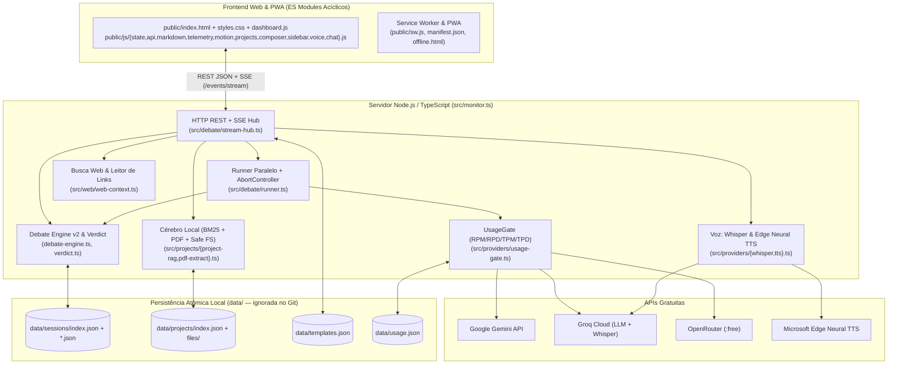

# AI Council — Intelligence Hub

> **Plataforma local de conversas e debates técnicos multi-IA com execução paralela via APIs gratuitas, Cérebro Local por Projeto (BM25 + PDF + pasta do PC), voz neural individual por IA, Veredito comparativo, busca na Web em tempo real, proteção rigorosa de cota (`UsageGate`), PWA mobile e ícone na bandeja do Windows.**

---

## Sumário

1. [Visão Geral e Recursos](#1-visão-geral-e-recursos)
2. [Arquitetura do Sistema](#2-arquitetura-do-sistema)
3. [Modos de Uso, Papéis e Orçamento de Contexto](#3-modos-de-uso-papéis-e-orçamento-de-contexto)
4. [Projetos / Pastas com "Cérebro Local" (RAG)](#4-projetos--pastas-com-cérebro-local-rag)
5. [Voz Completa: Groq Whisper + Vozes Neurais (Edge TTS)](#5-voz-completa-groq-whisper--vozes-neurais-edge-tts)
6. [Veredito do Conselho e Busca na Web](#6-veredito-do-conselho-e-busca-na-web)
7. [Proteção de Cota e Custo Zero (`UsageGate`)](#7-proteção-de-cota-e-custo-zero-usagegate)
8. [Desktop (Bandeja do Windows) e Celular (PWA / Remoto)](#8-desktop-bandeja-do-windows-e-celular-pwa--remoto)
9. [Estrutura do Projeto](#9-estrutura-do-projeto)
10. [Instalação, Configuração e Scripts](#10-instalação-configuração-e-scripts)
11. [Referência da API HTTP Local](#11-referência-da-api-http-local)
12. [Testes Automatizados e Integridade](#12-testes-automatizados-e-integridade)
13. [Solução de Problemas (Troubleshooting)](#13-solução-de-problemas-troubleshooting)

---

## 1. Visão Geral e Recursos

O **AI Council** reúne múltiplas IAs em um único painel rápido, privado e 100% gratuito, rodando no seu PC e acessível do celular.

### Principais Funcionalidades
- **Orquestração Multi-IA em Tempo Real (SSE Streaming):**
  - **Assentos Automáticos (API gratuita):** `Gemini` (Google), `Groq` e `OpenRouter (:free)` respondem em paralelo com streaming ao vivo token a token.
  - **Assentos Manuais Opcionais:** `ChatGPT` e `Claude` geram prompts contextuais prontos para copiar/colar sem automação intrusiva.
  - **Botão Parar real (`AbortController`):** interrompe imediatamente requisições e streams em andamento preservando o texto parcial já gerado.
- **Projetos / Pastas com "Cérebro Local":**
  - Instruções fixas por projeto + upload de arquivos/PDFs (com extração automática de texto) + vínculo opcional com pasta local do PC em modo **somente leitura** e busca local **BM25** sem custo de API.
- **Mensagem por Voz & Vozes Neurais Individuais por IA:**
  - Gravação segurando o microfone no PC ou celular via **Groq Whisper** (grátis).
  - Leitura das respostas e modo **"Ouvir Conselho"** (podcast sequencial) usando **Microsoft Edge Neural TTS** com voz e cadência próprias para cada IA.
- **Veredito do Conselho (Consenso vs. Divergência):**
  - Juiz automático (escolhido pela maior cota livre) gera 4 blocos estruturados — **Consenso**, **Divergências & Alertas**, **IA Recomendada** e **Síntese Prática** — destacando a vencedora e recolhendo automaticamente os demais cards.
- **Busca na Web + Leitor Automático de Links:**
  - Lê automaticamente até 3 URLs coladas (inclusive redirecionamentos do Google mobile, Instagram, Facebook e Reddit) e faz busca gratuita (DuckDuckGo + fallback Wikipedia) com proteção **anti-SSRF**.
- **Produtividade no Dia a Dia:**
  - **Anexos multimodais:** colar prints (`Ctrl + V`), arrastar ou anexar imagens (com compressão automática e lightbox) e PDFs.
  - **Busca full-text + Pin:** pesquisa instantânea por título e conteúdo completo (sem acento) + fixar conversas no topo.
  - **Templates editáveis:** biblioteca de prompts reutilizáveis na barra e no Zero State.
  - **Memória Compartilhada:** compactação automática em segundo plano de turnos antigos + edição manual compartilhada entre todas as IAs.
  - **Exportação `.md`** completa de qualquer conversa em 1 clique.
- **Interface Eraser Neon Blueprint em Largura Total:**
  - Layout responsivo de 3 colunas retráteis, cards das IAs em grade adaptativa lado a lado (sem corte lateral nem rolagem presa dentro do card) e frontend 100% modularizado em ES Modules acíclicos.

---

## 2. Arquitetura do Sistema



---

## 3. Modos de Uso, Papéis e Orçamento de Contexto

### 3.1. Combinações no Composer
- **Formato:** `Normal` (conversa natural e direta) ou `Prompt MD` (resposta técnica estruturada em Markdown, com foco `Geral`, `Backend` ou `Frontend`).
- **Dinâmica:** `Direto` (1 turno rápido com 1 IA ou com o Trio em paralelo) ou `Debate` (1 a 3 rodadas de crítica cruzada + Síntese Final do relator).
- **Atalhos rápidos:** `1 IA` ou `Trio` no composer e seletor **`Respondendo: ... ▾`** na barra superior para trocar a IA da próxima mensagem em 1 clique.

### 3.2. Papéis no Debate (`Prompt MD`)

| Plataforma | Foco: `geral` | Foco: `backend` | Foco: `frontend` |
| :--- | :--- | :--- | :--- |
| **Gemini** *(auto)* | Arquiteto e relator (síntese final). | Arquiteto e relator (contratos e merge). | Arquiteto e relator (estrutura e estado). |
| **Groq** *(auto)* | Revisor técnico (bugs, segurança e borda). | Auditor de segurança, concorrência e borda. | Auditor de XSS, acessibilidade e erros. |
| **OpenRouter** *(auto)* | Voz alternativa e otimização. | Revisor de simplicidade e desacoplamento. | Revisor de UX e estética sem cara genérica. |
| **ChatGPT / Claude** *(manuais)* | Autor alternativo / Revisor de qualidade. | Arquitetura alternativa / Código limpo. | Padrões de layout / Semântica e clareza. |

### 3.3. Orçamento Dinâmico por IA (`src/shared/context-budget.ts`)
Cada provedor recebe o histórico, anexos, fontes web e trechos do Projeto dimensionados para a sua janela gratuita (evitando que o Groq gratuito estoure `8.000 TPM`):

| Orçamento (caracteres) | Gemini | OpenRouter / Alto Contexto | Groq Gratuito (8k TPM) |
| :--- | :---: | :---: | :---: |
| Histórico unificado | `24.000` | `20.000` | `7.500` |
| Anexos de texto | `22.000` | `18.000` | `4.500` |
| **Contexto de Projeto (RAG)** | **`16.000`** | **`12.000`** | **`3.000`** |
| Contexto Web (links/busca) | `6.500` | `6.000` | `2.200` |
| Memória Compartilhada | `2.800` | `2.400` | `2.000` |

---

## 4. Projetos / Pastas com "Cérebro Local" (RAG)

Na barra lateral esquerda, a seção **`PROJETOS`** organiza conversas com contexto permanente:

- **Origem híbrida:**
  1. **Instruções fixas:** regras, stack, tom e restrições injetadas automaticamente em todos os turnos (inclusive nas rodadas de Crítica e Síntese).
  2. **Uploads no projeto (PC e celular):** arquivos `.md`, `.txt`, `.json`, `.csv`, `.yml`, código-fonte e **`.pdf`** (texto extraído automaticamente com `unpdf` e indexado para que **Gemini, Groq e OpenRouter** consigam consultar o conteúdo).
  3. **Pasta local do PC (opcional):** caminho de uma pasta local lido em modo **estritamente somente leitura**, com botão **`Testar Pasta`**.
- **Busca BM25 local (0 custo de API):**
  - Projetos pequenos (até `14.000` chars / 8 arquivos) enviam a base completa.
  - Projetos maiores quebram os arquivos em blocos sobrepostos e selecionam os trechos mais relevantes por pontuação **BM25 sem acentos**.
- **Trava rígida de segurança (não contornável):**
  - Bloqueia automaticamente `.env`, `.env.*`, `*.key`, `*.pem`, `*.p12`, `*.pfx`, `*.jks`, `id_rsa*`, `credentials*`, `*secret*`, `.git`, `node_modules`, `dist`, `build`, `.next`, `__pycache__`, bancos `.sqlite`/`.db` e binários.
- **Transparência no chat:** cada mensagem mostra a barra recolhível **`Contexto do Projeto · <Nome> (N trechos)`** listando exatamente quais arquivos/trechos foram usados.
- **Gestão segura:** qualquer conversa pode ser movida para dentro ou fora de um projeto pelo menu **`Projeto ▾`** na barra superior; excluir um projeto mantém suas conversas intactas em *Todos os chats*.

---

## 5. Voz Completa: Groq Whisper + Vozes Neurais (Edge TTS)

- **Entrada por Voz (Segurar para Gravar):**
  - Botão de microfone no composer usando **Groq `whisper-large-v3-turbo`** em português (fallback `whisper-large-v3`).
  - Soltar envia automaticamente; arrastar para a esquerda (> 75px) cancela; limite de 2 minutos.
- **Saída com Voz Neural Individual (`Microsoft Edge Neural TTS`):**
  - **Gemini:** `pt-BR-ThalitaMultilingualNeural` (equilibrada e clara)
  - **Groq:** `pt-BR-AntonioNeural` (`+6%` de velocidade, ágil e objetivo)
  - **OpenRouter:** `pt-BR-FranciscaNeural` (expressiva e alternativa)
  - **Juiz / Síntese:** `pt-BR-AntonioNeural` (`-2%` / `-4Hz`, tom grave de relator)
  - Cache LRU em memória (25 áudios / 30 min) + fallback automático para `speechSynthesis` nativo.
- **Modo "Ouvir Conselho" + Mini-Player Flutuante:**
  - Reproduz todas as respostas do turno em fila com pré-carregamento da próxima faixa, barra de progresso clicável, Play/Pause, Pular (`⏭`), velocidade (`1x`/`1.25x`/`1.5x`) e seletor `⚙` para personalizar a voz de cada IA.

---

## 6. Veredito do Conselho e Busca na Web

### 6.1. Veredito (Consenso vs. Divergência)
Quando 2 ou mais IAs respondem no turno, o botão **`Veredito`** aciona o juiz automático (escolhido por maior cota restante no `UsageGate` + bônus de contexto):
- Entrega **1. Consenso**, **2. Divergências & Alertas**, **3. Por que a IA venceu** e **4. Síntese Prática**.
- Marca a vencedora com selo dourado **`★ Recomendada`**, recolhe uma única vez os cards não vencedores para leitura limpa e oferece **`Ir para <IA>`**, **`Copiar síntese`**, **`Ouvir`** e **`Reavaliar ▾`** para trocar o juiz.

### 6.2. Busca na Web + Leitor Automático de Links
- Toggle **`Web: Auto | Off`** no composer.
- **Leitor de links:** extrai e lê automaticamente até 3 URLs coladas na mensagem, desembrulhando links de redirecionamento (`google.com/url?...`, Facebook, Instagram, Reddit).
- **Busca gratuita:** DuckDuckGo HTML/Lite (com filtro de anúncios) + fallback Wikipedia + leitura profunda das 2 melhores páginas.
- **Anti-SSRF:** bloqueia `localhost`, `127.0.0.1`, redes LAN privadas (`10.x`, `172.16-31.x`, `192.168.x`), Tailscale (`100.64.0.0/10`) e protocolos não-HTTP.
- Exibe a barra recolhível **`Fontes consultadas (N)`** com links clicáveis abaixo da mensagem.

---

## 7. Proteção de Cota e Custo Zero (`UsageGate`)

O módulo `src/providers/usage-gate.ts` atua antes de qualquer chamada externa:
- **Margem de segurança (`USAGE_SAFETY=0.9`):** trava em 90% dos limites diários/por minuto.
- **Janela deslizante de 60s (RPM / TPM)** + **contador diário persistido em `data/usage.json`** (respeitando `America/Los_Angeles` no Gemini e `UTC` na Groq/OpenRouter).
- **Trava estrita `:free` no OpenRouter:** recusa na inicialização qualquer modelo que não termine em `:free`.
- **Google Search Grounding do Gemini em opt-in (`GEMINI_WEB_GROUNDING=true`):** desativado por padrão para evitar `429` da cota separada do Free Tier (usando a busca web gratuita local).

---

## 8. Desktop (Bandeja do Windows) e Celular (PWA / Remoto)

### 8.1. Aplicativo de Bandeja do Windows (`scripts/win/`)
- Instale os atalhos na Área de Trabalho e Menu Iniciar com:
  ```powershell
  npm.cmd run install:shortcuts
  ```
- Ou inicie diretamente pela bandeja com `npm.cmd run tray`.
- Clique com o **botão direito** no ícone do AI Council ao lado do relógio para **Abrir no navegador**, **Iniciar / Parar / Reiniciar servidor**, ativar **Iniciar com o Windows** ou **Abrir logs**.

### 8.2. Acesso no Celular (Wi-Fi Local ou Tailscale HTTPS) + PWA
- O servidor escuta em `0.0.0.0:4317` (configurável por `HOST` e `PORT`).
- Acesso local no PC (`127.0.0.1:4317`) entra direto; acessos remotos (Wi-Fi / Tailscale HTTPS) exibem a tela de bloqueio protegida por `ACCESS_PASSWORD` com cookie `HttpOnly` + botão **Bloquear**.
- Inclui `manifest.json`, `sw.js`, `offline.html` e ícones oficiais em `public/icons/` para adicionar à tela inicial do celular.

---

## 9. Estrutura do Projeto

```text
AI-Council/
├── data/                              # Persistência local (ignorada no Git)
│   ├── sessions/                      # index.json + um JSON por conversa
│   ├── projects/                      # index.json + arquivos indexados por projeto
│   ├── templates.json                 # Biblioteca de templates editáveis
│   ├── usage.json                     # Contadores diários do UsageGate
│   └── monitor-events.json            # Histórico de alertas/eventos
├── public/                            # Frontend Web + PWA (ES Modules)
│   ├── index.html                     # Shell principal, modais e player de voz
│   ├── styles.css                     # Eraser Neon Blueprint (Desktop & Mobile)
│   ├── dashboard.js                   # Ponto de entrada, bindings e registro de hooks
│   ├── manifest.json / sw.js / offline.html
│   ├── icons/                         # Ícones SVG, PNG (192/512/maskable) e ICO
│   └── js/
│       ├── state.js                   # Estado reativo, constantes, timers e uiHooks
│       ├── api.js                     # REST client, auth, SSE e sincronização
│       ├── markdown.js                # Parser Markdown seguro, syntax highlight e export .md
│       ├── telemetry.js               # Dock direito, cotas, cronômetros e monitoramento
│       ├── motion.js                  # Scroll inteligente, minimapa, parallax e lightbox
│       ├── projects.js                # Sidebar de projetos, modal, pasta PC e uploads
│       ├── composer.js                # Composer, anexos multimodais, memória e templates
│       ├── sidebar.js                 # Lista de conversas, busca, pin, topbar e ações
│       ├── voice.js                   # Gravador Whisper + player Edge Neural TTS + fila
│       └── chat.js                    # Renderização de turnos, Veredito, fontes e streams
├── scripts/
│   ├── win/                           # Bandeja Windows (tray.ps1, launch-tray.vbs, install-shortcuts.ps1)
│   ├── tunnel.ts                      # Auxiliar de túnel remoto
│   ├── test-providers.ts              # Teste real ou --dry das chaves de API
│   └── list-free-models.ts            # Lista modelos gratuitos disponíveis
├── src/
│   ├── debate/
│   │   ├── debate-engine.ts           # Máquina de estados, turnos, prompts e memória
│   │   ├── runner.ts                  # Execução paralela automática + AbortController
│   │   ├── stream-hub.ts              # Barramento SSE em tempo real
│   │   └── verdict.ts                 # Juiz inteligente (Consenso vs. Divergência)
│   ├── persistence/
│   │   ├── debate-store.ts            # Persistência atômica por sessão + busca full-text
│   │   ├── project-store.ts           # CRUD atômico de Projetos e arquivos enviados
│   │   └── template-store.ts          # CRUD atômico de Templates
│   ├── projects/
│   │   ├── pdf-extract.ts             # Extração de texto de PDFs (unpdf)
│   │   └── project-rag.ts             # BM25 local, chunking e scanner somente-leitura seguro
│   ├── providers/
│   │   ├── gemini.ts                  # Adaptador Google GenAI (texto + visão + PDF)
│   │   ├── openai-compat.ts           # Adaptador Groq e OpenRouter (:free)
│   │   ├── whisper.ts                 # Transcrição de voz via Groq Whisper
│   │   ├── tts.ts                     # Síntese neural individual via Microsoft Edge TTS
│   │   ├── policy.ts / registry.ts / types.ts / usage-gate.ts
│   ├── shared/
│   │   ├── debate-types.ts            # Contratos TypeScript compartilhados
│   │   └── context-budget.ts          # Orçamentos de contexto por provedor
│   ├── web/
│   │   └── web-context.ts             # Busca web gratuita, leitor de URLs e anti-SSRF
│   └── monitor.ts                     # Servidor HTTP, autenticação e rotas REST/SSE
├── tests/                             # Suíte automatizada (node:test via tsx — 37 testes)
│   ├── context-budget.test.ts
│   ├── debate-engine.test.ts
│   ├── frontend-integrity.test.ts
│   ├── projects.test.ts
│   ├── usage-gate.test.ts
│   ├── verdict.test.ts
│   ├── voice.test.ts
│   └── web-context.test.ts
├── .env.example                       # Modelo limpo de variáveis de ambiente
├── package.json
└── tsconfig.json
```

---

## 10. Instalação, Configuração e Scripts

### 10.1. Pré-requisitos e Instalação
- **Node.js `v20+`** (recomendado `v22+`)
- Instale as dependências (no Windows PowerShell use `npm.cmd`):
  ```powershell
  npm.cmd install
  ```

### 10.2. Configuração do `.env`
Copie `.env.example` para `.env` e preencha suas chaves (nunca versione o `.env`):

| Variável | Obrigatória | Padrão | Descrição |
| :--- | :---: | :--- | :--- |
| `MONITOR_TOKEN` | **Sim** | — | Token local de segurança (mín. 32 chars). |
| `ACCESS_PASSWORD` | Rec. | `aicouncil2026` | Senha para acesso remoto/celular (Wi-Fi/HTTPS). |
| `REQUIRE_PASSWORD_LOCAL` | Não | `false` | Se `true`, exige senha também no `127.0.0.1`. |
| `GEMINI_API_KEY` | **Sim** | — | Chave gratuita do Google AI Studio. |
| `GROQ_API_KEY` | **Sim** | — | Chave gratuita da Groq Cloud (LLM + Whisper). |
| `OPENROUTER_API_KEY` | **Sim** | — | Chave gratuita do OpenRouter. |
| `GEMINI_MODELS` | Não | `gemini-3.5-flash-lite,...` | Lista de modelos Gemini (principal + fallback). |
| `GROQ_MODELS` | Não | `openai/gpt-oss-120b,...` | Lista de modelos Groq (principal + fallback). |
| `OPENROUTER_MODELS` | Não | `...:free` | Lista OpenRouter (**obrigatório sufixo `:free`**). |
| `GEMINI_WEB_GROUNDING` | Não | `false` | Habilita Google Search nativo do Gemini (opt-in). |
| `HOST` / `PORT` | Não | `0.0.0.0` / `4317` | Interface de rede e porta do servidor HTTP. |
| `USAGE_SAFETY` | Não | `0.9` | Trava preventiva de cota (`0.9` = 90%). |
| `AI_COUNCIL_DATA_DIR` | Não | `./data` | Diretório alternativo de dados (usado nos testes). |

### 10.3. Scripts Disponíveis

| Comando | Descrição |
| :--- | :--- |
| `npm.cmd run build` | Compila TypeScript para `dist/`. |
| `npm.cmd test` | Executa toda a suíte automatizada (`37` testes). |
| `npm.cmd run start` | Executa o servidor compilado (`node dist/monitor.js`). |
| `npm.cmd run monitor` | Executa o servidor diretamente em TypeScript (`tsx`). |
| `npm.cmd run dev` | Executa em modo *watch* recarregando alterações em `src/`. |
| `npm.cmd run tray` | Abre o ícone controlador na bandeja do Windows. |
| `npm.cmd run install:shortcuts` | Cria os atalhos no Desktop e Menu Iniciar do Windows. |
| `npm.cmd run test:providers:dry` | Valida `.env` e modelos sem fazer chamadas externas. |
| `npm.cmd run test:providers` | Testa conectividade real com cada provedor configurado. |
| `npm.cmd run list-models` | Lista modelos gratuitos disponíveis nas APIs. |

---

## 11. Referência da API HTTP Local

Todas as rotas autenticadas aceitam acesso local (`127.0.0.1`), sessão remota (`Cookie`/`X-AI-Council-Session`) ou `X-AI-Council-Token`.

| Grupo | Endpoints |
| :--- | :--- |
| **Sistema & Auth** | `GET /health`, `GET /status`, `GET /providers`, `GET /events/stream` (SSE), `GET /auth/status`, `POST /auth/login`, `POST /auth/logout` |
| **Conversas & Debates** | `GET/POST /debates`, `GET /debates/search?q=`, `GET/PATCH/DELETE /debates/:id`, `POST /debates/:id/{message,respond,stop,pause,resume,regenerate,review,verdict,memory,rename,pin,project,delete}` |
| **Projetos (Cérebro Local)** | `GET/POST /projects`, `POST /projects/inspect-folder`, `GET/PATCH/DELETE /projects/:id`, `POST /projects/:id/files`, `DELETE /projects/:id/files/:fileId` |
| **Templates** | `GET/POST /templates`, `PATCH/DELETE /templates/:id` |
| **Voz (Áudio)** | `POST /audio/transcribe` (Groq Whisper), `POST /audio/speak` (Microsoft Edge Neural TTS) |

---

## 12. Testes Automatizados e Integridade

Execute `npm.cmd test` para validar todas as 9 suítes (37 testes em ~1s):
- **`tests/projects.test.ts`:** bloqueio de segredos (`.env`, `.pem`, `.key`, `.git`, `node_modules`, binários), BM25 em bases grandes e orçamento Groq vs. Gemini.
- **`tests/frontend-integrity.test.ts`:** `node --check` em todos os módulos JS, grafo de imports **100% acíclico**, zero símbolos faltantes entre módulos, zero referências sem prefixo `state.` e simulação completa de boot + renderização (incluindo Projetos, Veredito e anexos).
- **`tests/voice.test.ts`:** normalização de áudio Android/iOS, limpeza de Markdown para fala e vozes individuais por IA.
- **`tests/verdict.test.ts`:** parsing resiliente de JSON, empates e compactação por orçamento.
- **`tests/web-context.test.ts`:** anti-SSRF, desembrulhamento de links de redirecionamento e limpeza de HTML.
- **`tests/debate-engine.test.ts`**, **`tests/usage-gate.test.ts`**, **`tests/context-budget.test.ts`**.

---

## 13. Solução de Problemas (Troubleshooting)

| Sintoma | Causa Provável | Solução |
| :--- | :--- | :--- |
| **`Error: listen EADDRINUSE 0.0.0.0:4317`** | O servidor já está rodando em segundo plano (iniciado pela bandeja do Windows). | Não precisa rodar `npm.cmd run monitor`; use o ícone na bandeja (**Botão direito → Reiniciar servidor**) ou pare-o antes de abrir no terminal. |
| **Erro ao rodar `npm` no PowerShell** | Política `ExecutionPolicy` bloqueando `npm.ps1`. | Utilize `npm.cmd` (ex.: `npm.cmd run build`, `npm.cmd test`). |
| **Card da IA exibe `Sem chave`** | Chave ausente no `.env` ou modelo OpenRouter sem `:free`. | Confira o `.env` e rode `npm.cmd run test:providers:dry`. |
| **Debate pausado por limite gratuito** | Cota diária/minuto (`UsageGate`) ou `429` atingido. | Aguarde a janela renovar e clique em **`Retomar →`** no topo do chat. |
| **Mudanças visuais não apareceram** | Cache do navegador/Service Worker. | Pressione **`Ctrl + F5`** no PC (ou recarregue a aba no celular). |
